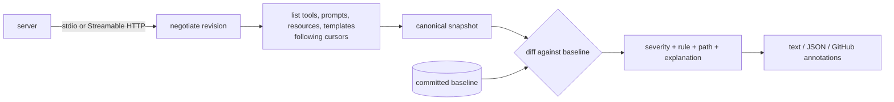

# mcp-contract

[](https://github.com/aozmekik/mcp-contract/actions/workflows/ci.yml)
[](LICENSE)

Contract testing for [Model Context Protocol](https://modelcontextprotocol.io) servers: snapshot
the tools, resources and prompts a server exposes, and classify every change as **breaking**,
**non-breaking** or **unknown** from the client's point of view, so schema changes don't
silently break agents.

> Status: early, v0.1.0. The CLI, snapshot format and library API may change. Not yet
> published to npm.

## Why

An MCP server's contract is its tool, prompt and resource definitions, mostly JSON Schemas.
Agents and their prompts are built against those schemas, and nothing in the protocol stops a
server release from lowering a `maximum`, making an argument required, or dropping a result
field. Unit tests of the server rarely notice: they test the new behaviour, not the old
contract. mcp-contract records the contract once, commits it, and fails CI when a change would
break clients written against it.

## Features

- **Snapshot** a live server over stdio or Streamable HTTP. Negotiates the current revision,
  [2026-07-28](https://modelcontextprotocol.io/specification/2026-07-28), and falls back to the
  `initialize` handshake of 2025-era servers. Follows pagination cursors (and refuses to loop on
  repeated ones). Writes a canonical, deterministic file: sorted keys, sorted lists, no
  timestamps.
- **Diff** two snapshots, or **check** a live server against the committed one. Every change
  gets a severity, a stable rule code, a location such as `inputSchema $.filters[*].tag`, and
  an explanation.
- **Direction-aware JSON Schema analysis**: narrowing a tool's input is breaking, widening its
  output is breaking. Covers types, `enum`/`const`, numeric and string bounds, arrays and tuples,
  `properties`/`required`/`additionalProperties`, `allOf`/`anyOf`/`oneOf`, and local
  `$ref`/`$defs` including recursive definitions. Whatever cannot be proven is `unknown`, never
  guessed.
- **Scenarios**: YAML fixture tool calls with subset matching, JSONPath-style selectors,
  operators (`$regex`, `$type`, `$length`, `$contains`, comparisons), and `isError` or
  protocol-error expectations.
- **CI-ready output**: text (colored on a terminal), JSON, or GitHub workflow annotations plus a
  Markdown table in `$GITHUB_STEP_SUMMARY`; exit codes 0 / 1 / 2 / 3.
- **Library API** for Vitest, Jest or `node:test`: `snapshotServer()`, `diffSnapshots()`,
  `expectNoBreakingChanges()`.
- **Composite GitHub Action** in this repository (not published on the Marketplace).
- Spawned servers are cleaned up on success, timeout, crash, Ctrl-C, and even when the server
  ignores stdin EOF and `SIGTERM` (each case has a test).

## Install

Requires Node.js 22 or newer. Not yet published to npm; install from GitHub:

```sh
npm install --save-dev github:aozmekik/mcp-contract
npx mcp-contract --help
```

Installing from Git builds the package locally through its `prepare` script (TypeScript and
tsup are fetched as development dependencies for that step). The build tooling expects Node
22.18 or newer.

## Quick start

```sh
# 1. Record the contract and commit it.
npx mcp-contract snapshot --stdio "node dist/server.js"      # writes mcp-contract.snapshot.json
git add mcp-contract.snapshot.json

# 2. In CI (or before a release): compare the live server with the baseline.
npx mcp-contract check --stdio "node dist/server.js"

# Remote servers work the same way.
npx mcp-contract check --url https://mcp.example.com/mcp --header "Authorization=Bearer $TOKEN"
```

When a change is intended, re-run `snapshot` and commit the new baseline; the diff in the pull
request documents the contract change.

This is the real output of checking the example v2 server against the v1 baseline
(`examples/notes-server/`), abridged:

```text
21 changes: 8 breaking, 3 unknown, 10 non-breaking.

tool create_note
  BREAKING      inputSchema $.folder: new required property `folder`; requests without it are now rejected
  NON-BREAKING  inputSchema $.title: maxLength loosened from 200 to 500; arguments that were valid before are still accepted

tool get_note
  UNKNOWN       inputSchema $.id: pattern changed from "^n_[0-9]+$" to "^note_[0-9a-f]+$"; mcp-contract cannot decide whether one regular expression accepts everything another one does
  BREAKING      outputSchema $.body: may now also be null; results can now contain values that clients written against the old schema do not expect

tool search_notes
  NON-BREAKING  inputSchema $.cursor: new optional property `cursor`; existing clients do not send it, so they are unaffected
  BREAKING      inputSchema $.limit: upper bound tightened from <= 100 to <= 50; arguments that were valid before can now be rejected
  BREAKING      outputSchema $.results[*].score: field `score` removed; clients that read it will no longer receive it

prompt summarize_note
  BREAKING      arguments.style: argument `style` is now required; requests without it are rejected

FAIL: 11 changes at or above the fail-on threshold (unknown)
```

## CLI

```text
mcp-contract snapshot (--stdio <command> | --url <url>) [-o <file>]
mcp-contract diff <old.json> <new.json>
mcp-contract check (--stdio <command> | --url <url>) [--snapshot <file>]
mcp-contract test <scenarios.yaml> [--stdio <command> | --url <url>]
```

| Option                                | Applies to            | Meaning                                                                                                                                                                                                |
| ------------------------------------- | --------------------- | ------------------------------------------------------------------------------------------------------------------------------------------------------------------------------------------------------ |
| `--stdio <command>`                   | snapshot, check, test | Spawn the server. The command is split like a shell would (quotes, backslashes) but without expansion, globbing or pipes; use `sh -c '...'` if you need those.                                         |
| `--url <url>`                         | snapshot, check, test | Streamable HTTP endpoint.                                                                                                                                                                              |
| `--header <name=value>`               | with `--url`          | Repeatable.                                                                                                                                                                                            |
| `--cwd <dir>`, `--env <name[=value]>` | with `--stdio`        | Working directory; extra environment variables (without a value, copied from the current environment). The child gets the SDK's safe default environment plus these, not the whole parent environment. |
| `--protocol <mode>`                   | snapshot, check, test | `auto` (default), `legacy` (2025 handshake only, no probe), or a revision to require, such as `2026-07-28`.                                                                                            |
| `--timeout <ms>`                      | snapshot, check, test | Per request, default 30000.                                                                                                                                                                            |
| `--server-stderr <mode>`              | with `--stdio`        | `pipe` (default: kept and shown if something fails), `inherit`, `ignore`.                                                                                                                              |
| `--format <format>`                   | diff, check, test     | `text` (default), `json`, `github`.                                                                                                                                                                    |
| `--fail-on <level>`                   | diff, check           | `breaking`, `unknown` (default), or `any` (fail on any change, to detect drift).                                                                                                                       |
| `--color`, `--no-color`               | diff, check, test     | Override color detection (`NO_COLOR` and `FORCE_COLOR` are honoured).                                                                                                                                  |
| `-o, --output <file>`                 | snapshot              | Output file (default `mcp-contract.snapshot.json`), `-` for stdout.                                                                                                                                    |
| `--snapshot <file>`                   | check                 | Baseline (default `mcp-contract.snapshot.json`).                                                                                                                                                       |

Exit codes: `0` passed, `1` contract failure (changes at or above `--fail-on`, or failing
scenarios), `2` usage or input error (bad flags, unreadable or invalid snapshot or scenario
file), `3` server error (cannot start, connect, or the server misbehaves), `130` interrupted.

`--format github` prints one workflow annotation per change (`error` for breaking, `warning`
for unknown, `notice` for non-breaking) followed by the text report, and appends a Markdown
table to `$GITHUB_STEP_SUMMARY` when that variable is set. `--format json` prints
`{ passed, failOn, summary, changes }`; the shape of a change is the `Change` type in
[`src/diff/model.ts`](src/diff/model.ts).

## How changes are classified

The question is always "can a client written against the old contract keep working?". For a
tool's `inputSchema` the client sends the data, so the new schema must accept everything the old
one accepted. For `outputSchema` the server sends the data, so everything it may now send must be
something clients already handle.

| Change                                                                                            | Input schema                                                 | Output schema                     |
| ------------------------------------------------------------------------------------------------- | ------------------------------------------------------------ | --------------------------------- |
| Type narrowed (`["string","null"]` to `"string"`, `number` to `integer`)                          | breaking                                                     | non-breaking                      |
| Type widened, nullable added (`type` array or `anyOf` with `null`)                                | non-breaking                                                 | breaking                          |
| Enum value removed / added                                                                        | breaking / non-breaking                                      | non-breaking / breaking           |
| `minimum`, `maximum`, `minLength`, `maxItems`, ... tightened / loosened                           | breaking / non-breaking                                      | non-breaking / breaking           |
| `pattern` or `format` added / removed / changed                                                   | breaking / non-breaking / unknown                            | non-breaking / breaking / unknown |
| Required property added                                                                           | breaking                                                     | non-breaking                      |
| Optional property added                                                                           | non-breaking (A1)                                            | non-breaking (A2)                 |
| Property removed                                                                                  | breaking if `additionalProperties: false`, else non-breaking | breaking                          |
| Property became required / optional                                                               | breaking / non-breaking                                      | non-breaking / breaking           |
| `additionalProperties` set to `false`                                                             | breaking                                                     | non-breaking                      |
| `anyOf` alternative added / removed                                                               | non-breaking / breaking                                      | breaking / non-breaking           |
| `oneOf` change that would otherwise be compatible                                                 | unknown                                                      | unknown                           |
| `allOf` member added / removed                                                                    | breaking / non-breaking                                      | non-breaking / breaking           |
| `default` changed                                                                                 | unknown                                                      | non-breaking                      |
| `not`, `if`/`then`/`else`, unknown keywords, `x-mcp-header`, dialect, unresolvable `$ref` changed | unknown                                                      | unknown                           |
| Description, title, examples, deprecation                                                         | non-breaking                                                 | non-breaking                      |

Beyond schemas: removed tools, prompts, resources and templates are breaking, additions are not;
a removed `outputSchema` is breaking; a resource MIME type change is breaking; removed
capabilities (or `listChanged`/`subscribe` turned off) are breaking; new required prompt arguments
are breaking; tool behaviour hints that become riskier (`readOnlyHint` true to false,
`destructiveHint` or `openWorldHint` false to true, using the specification's defaults) are
unknown so that approval policies get reviewed; task support that drops an invocation mode is
breaking; `_meta` and fields without a rule are unknown; a changed negotiated protocol revision
is unknown.

Two assumptions keep the verdicts useful; both are documented in
[ADR 0002](docs/adr/0002-compatibility-rules.md):

- **A1:** clients only send properties the old schema declares at that location. If another
  alternative declares the property, or a map-like `additionalProperties` schema accepts any
  key, an added property is `unknown` instead.
- **A2:** clients ignore result fields they do not know.

## Scenarios

```yaml
# scenarios.yaml
server: # optional; --stdio/--url override it
  command: node # cwd defaults to this file's directory
  args: [dist/server.js]
  env: { LOG_LEVEL: warn } # or: url: http://localhost:3000/mcp, headers: {...}

scenarios:
  - name: search finds notes
    tool: search_notes
    arguments: { query: protocol, limit: 5 }
    timeoutMs: 5000 # optional, per call
    expect:
      select: # every selected value must match
        $.structuredContent.total: { $gte: 1 }
        $.structuredContent.results[*].id: { $regex: '^n_[0-9]+$' }
        $.content[0].type: text # literals match by (subset) equality
  - name: unknown ids are tool errors
    tool: get_note
    arguments: { id: n_999 }
    expect:
      isError: true # defaults to false
      result: { content: [{ type: text }] } # subset match on the whole result
  - name: unknown tools are protocol errors
    tool: rename_note
    expect:
      error: { code: -32602 } # the call must fail with this JSON-RPC error
```

- **Matching:** objects match when every listed key matches (extra keys are fine); arrays match
  element by element with equal length; primitives by equality. An object whose keys all start
  with `$` is an operator object: `$equals` (exact), `$regex` (with optional `$flags`), `$type`
  (`string`, `number`, `integer`, `boolean`, `null`, `array`, `object`), `$length`, `$contains`
  (substring or array element), `$exists`, `$gt`, `$gte`, `$lt`, `$lte`.
- **Selectors** are a documented subset of JSONPath ([RFC 9535](https://www.rfc-editor.org/rfc/rfc9535)):
  `$`, `.name`, `['name']`, `[0]`, `[-1]`, `.*`, `[*]`. Filters, slices and `..` are rejected
  when the file is loaded. A selector that matches nothing fails, unless the expectation is
  `{ $exists: false }`.
- The whole file is validated (structure, duplicate names, selectors, operators, regular
  expressions) before any server is started. Scenarios run sequentially; a failure does not
  stop the run. The tool list is fetched first, so the SDK also validates `structuredContent`
  against each tool's `outputSchema`.

## Library

```ts
import { expectNoBreakingChanges, readSnapshot, snapshotServer } from 'mcp-contract';
import { test } from 'vitest';

test('the MCP contract stays backwards compatible', async () => {
  const baseline = await readSnapshot('mcp-contract.snapshot.json');
  const current = await snapshotServer({
    type: 'stdio',
    command: 'node',
    args: ['dist/server.js'],
  });
  expectNoBreakingChanges(baseline, current); // throws ContractViolationError with the full report
});
```

| Export                                                                | Purpose                                                                                                                                                                                                                 |
| --------------------------------------------------------------------- | ----------------------------------------------------------------------------------------------------------------------------------------------------------------------------------------------------------------------- |
| `snapshotServer(target, options?)`                                    | Connect, capture, disconnect. Targets: `{ type: 'stdio', command, args?, cwd?, env? }`, `{ type: 'http', url, headers? }`, or `{ type: 'transport', transport }` for any SDK transport (for example an in-memory pair). |
| `connectServer(target, options?)` / `captureSnapshot(connection)`     | The same in two steps; the connection is `AsyncDisposable` (`await using`).                                                                                                                                             |
| `diffSnapshots(before, after)`                                        | `{ changes, summary }`, deterministic order.                                                                                                                                                                            |
| `diffSchemas(before, after, { direction })`                           | The schema engine on its own, for `'input'` or `'output'` data.                                                                                                                                                         |
| `expectNoBreakingChanges(baseline, current, { failOn? })`             | Framework-agnostic assertion; defaults to failing on breaking and unknown changes.                                                                                                                                      |
| `loadScenarios(path)` / `runScenarios(connection, scenarios)`         | Scenario files from code.                                                                                                                                                                                               |
| `readSnapshot`, `writeSnapshot`, `serializeSnapshot`, `parseSnapshot` | Snapshot files.                                                                                                                                                                                                         |
| `formatDiffText`, `formatDiffJson`, `formatDiffMarkdown`              | Reports.                                                                                                                                                                                                                |

Every export has TSDoc comments; see [`src/index.ts`](src/index.ts).

## GitHub Action

The repository contains a composite action. It is not published on the GitHub Marketplace; pin
it to a tag or commit of this repository:

```yaml
- uses: actions/checkout@v7
- run: npm ci && npm run build # build your server
- uses: aozmekik/mcp-contract@v0.1.0 # or a commit SHA
  with:
    command: check # check (default), test, snapshot or diff
    stdio: node dist/server.js # or url: + headers:
    snapshot: mcp-contract.snapshot.json
    fail-on: unknown
```

Inputs: `command`, `stdio`, `url`, `headers` (one `name=value` per line), `snapshot`, `baseline`
(for `diff`), `scenarios` (for `test`), `fail-on`, `protocol`, `working-directory`,
`node-version` (default `24`; empty to use the runner's Node). The action builds mcp-contract
from its own checkout and runs it with `--format github`, so findings appear as annotations and
in the job summary. Inputs reach the script only through environment variables. This
repository's CI uses the action against the example servers, including a run that is expected to
fail.

## Design



- [ADR 0001](docs/adr/0001-sdk-v2-and-protocol-2026-07-28.md): built on the official v2
  TypeScript SDK (`@modelcontextprotocol/client` 2.x) rather than the v1
  `@modelcontextprotocol/sdk`, whose maintenance line implements the specification only up to
  2025-11-25. Trade-off: with `--protocol auto`, the SDK probes stdio servers on a short-lived
  sibling process, so each check starts the server twice.
- [ADR 0002](docs/adr/0002-compatibility-rules.md): compatibility as set inclusion per keyword,
  in the direction the data flows, with two explicit assumptions and an `unknown` verdict instead
  of guesses. Recursive schemas are compared coinductively; a step budget bounds pathological
  schemas.
- [ADR 0003](docs/adr/0003-canonical-snapshots.md): snapshots are the MCP JSON in canonical form
  (RFC 8785 key order), so an unchanged server produces byte-identical files.
- The CLI is a pure function of `argv` and injected I/O (`src/cli/main.ts`); the bin only wires
  `process` into it and turns SIGINT/SIGTERM into an abort signal.
- Sources are written in erasable TypeScript syntax and run directly under Node's type stripping
  (the examples, fixtures and scripts do), while the published package is a tsup bundle with
  declarations.

## Verification

All numbers below come from commands run on an Apple M1 Pro (8 cores, 16 GB RAM), macOS 26.6,
Node v22.22.3, npm 10.9.8. Other jobs were running on the machine at the same time (load average
about 20 to 60 on 8 cores), so timings are noisy.

| What                            | Command                                                                                               | Result                                                                                      |
| ------------------------------- | ----------------------------------------------------------------------------------------------------- | ------------------------------------------------------------------------------------------- |
| Tests                           | `npm run coverage`                                                                                    | 393 tests in 18 files, all passing                                                          |
| Coverage (v8)                   | `npm run coverage`                                                                                    | statements 97.07%, branches 92.79%, functions 98.46%, lines 97.04%                          |
| Lint                            | `npm run lint`                                                                                        | 0 errors, 0 warnings (typescript-eslint `strictTypeChecked` + `stylisticTypeChecked`)       |
| Soundness property, default     | `npx vitest run test/property`                                                                        | 400 cases per property, fixed seed                                                          |
| Soundness property, long search | `MCP_CONTRACT_FC_RUNS=20000 MCP_CONTRACT_FC_SEED=<1..8> npx vitest run test/property --testTimeout=0` | 8 seeds x 20,000 cases x 30 instances per property, no counterexample (24 to 28 s per seed) |

The soundness test is the main evidence for the `non-breaking` verdict. It generates random
schemas (including guarded recursive `$ref` definitions), mutates them, and whenever the engine
reports no breaking and no unknown change it asks [Ajv](https://ajv.js.org) (an independent
JSON Schema 2020-12 validator) to confirm that sampled instances behave as claimed under
assumptions A1 and A2. Long searches during development found four engine defects, and
writing the test exposed two more; all six are fixed and covered by unit tests. The test is described in
[ADR 0002](docs/adr/0002-compatibility-rules.md#verification).

## Benchmarks

Diff engine, `npm run bench` (`scripts/bench.ts`): median and 95th percentile of
`diffSnapshots(before, after)` per call, after warm-up. The synthetic case is generated data,
not a real server: 200 tools with 25 properties each (strings, integers, enums, nullable unions,
nested objects with arrays), where every tenth tool tightens one bound and drops one enum value.

| Case                                              | Iterations | Median   | p95      |
| ------------------------------------------------- | ---------- | -------- | -------- |
| Example v1 to v2 (21 changes)                     | 2000       | 0.304 ms | 0.947 ms |
| Example v1 to v1 (no changes)                     | 2000       | 0.198 ms | 0.316 ms |
| Synthetic, 200 tools x 25 properties (40 changes) | 50         | 42.8 ms  | 52.0 ms  |

End to end with the built CLI against the example server over stdio, measured with
`hyperfine --warmup 3 --runs 20` (hyperfine 2.0.0); `v1.snapshot.json` stands for
`examples/notes-server/v1.snapshot.json`:

| Command                                                                                                | Mean               |
| ------------------------------------------------------------------------------------------------------ | ------------------ |
| `node dist/cli.js diff v1.snapshot.json v1.snapshot.json`                                              | 170.9 ms ± 10.0 ms |
| `node dist/cli.js check --stdio "node examples/notes-server/v1.ts" --snapshot ...` (`--protocol auto`) | 637.6 ms ± 44.5 ms |
| the same with `--protocol legacy --fail-on breaking`                                                   | 426.2 ms ± 34.9 ms |

Most of the CLI time is process start-up (Node, and the example server running TypeScript
through type stripping). The difference between `auto` and `legacy`, about 210 ms here, is the
SDK's protocol probe on a second server process.

## Limitations

- Regular-expression inclusion is not decided: any `pattern` change is `unknown`, as are changes
  to `not`, `if`/`then`/`else`, `contains`, `dependentSchemas`, `unevaluated*`,
  `patternProperties` and keywords mcp-contract does not model.
- Only same-document references (`#`, `#/...`) are followed. Remote references are never fetched
  (the MCP specification forbids it by default); named anchors and `$dynamicRef` are not
  resolved. Changes involving them are `unknown`.
- `breaking` can be conservative: narrowing one `anyOf` alternative is reported as breaking even
  when another alternative still accepts the same values.
- A renamed tool, prompt or resource is reported as one removal plus one addition.
- Servers with dynamic resource lists (for example one resource per file) produce snapshots that
  change with their data; there is no filter yet.
- Scenarios cover `tools/call` only, not `prompts/get` or `resources/read`.
- HTTP authentication is limited to static headers; there is no OAuth flow.
- With `--protocol auto`, a stdio server is started twice per run (see ADR 0001).
- CI covers Linux and macOS. Windows is untested.

## Roadmap

These were left out of 0.1.0 to keep what ships correct and tested:

- `check --update` to rewrite the baseline in place.
- A configuration file to accept known changes (by rule code, element and path) and to exclude
  volatile resources.
- Scenario steps for `prompts/get` and `resources/read`, and a JSON Schema for scenario files.
- Rename hints when a removed and an added element are nearly identical.
- Deciding inclusion for simple regular expressions (for example literal prefixes).
- OAuth for Streamable HTTP servers.
- Publishing to npm and to the GitHub Marketplace.

## Contributing

See [CONTRIBUTING.md](CONTRIBUTING.md) for setup, the commands CI runs, the project layout, and
how to add a compatibility rule. Changes are recorded in [CHANGELOG.md](CHANGELOG.md).

## References and inspiration

- [MCP specification, revision 2026-07-28](https://modelcontextprotocol.io/specification/2026-07-28):
  [tools](https://modelcontextprotocol.io/specification/2026-07-28/server/tools),
  [JSON Schema usage and `$ref` resolution](https://modelcontextprotocol.io/specification/2026-07-28/basic/index),
  [versioning](https://modelcontextprotocol.io/specification/versioning).
- [MCP TypeScript SDK](https://github.com/modelcontextprotocol/typescript-sdk) v2 (client and
  server packages).
- [JSON Schema 2020-12](https://json-schema.org/draft/2020-12) core and validation vocabularies.
- [RFC 8785](https://www.rfc-editor.org/rfc/rfc8785) (JSON Canonicalization Scheme) for key
  order, [RFC 6901](https://www.rfc-editor.org/rfc/rfc6901) (JSON Pointer) for `$ref`,
  [RFC 9535](https://www.rfc-editor.org/rfc/rfc9535) (JSONPath) for the selector subset.
- Breaking-change checkers for other interface languages inspired the approach, notably
  `buf breaking` for Protocol Buffers and OpenAPI diff tools such as oasdiff. No code was taken
  from them.
- [Ajv](https://ajv.js.org) and [fast-check](https://fast-check.dev) power the soundness test;
  the coinductive treatment of recursive schemas follows the standard approach to subtyping
  recursive types (Amadio and Cardelli, "Subtyping Recursive Types", 1993).
- [GitHub workflow commands](https://docs.github.com/actions/reference/workflow-commands-for-github-actions)
  and the [NO_COLOR](https://no-color.org) convention.

## License

[MIT](LICENSE)

Built by [Ahmed Semih Özmekik](https://github.com/aozmekik) at [Fergani](https://fergani.tr).
